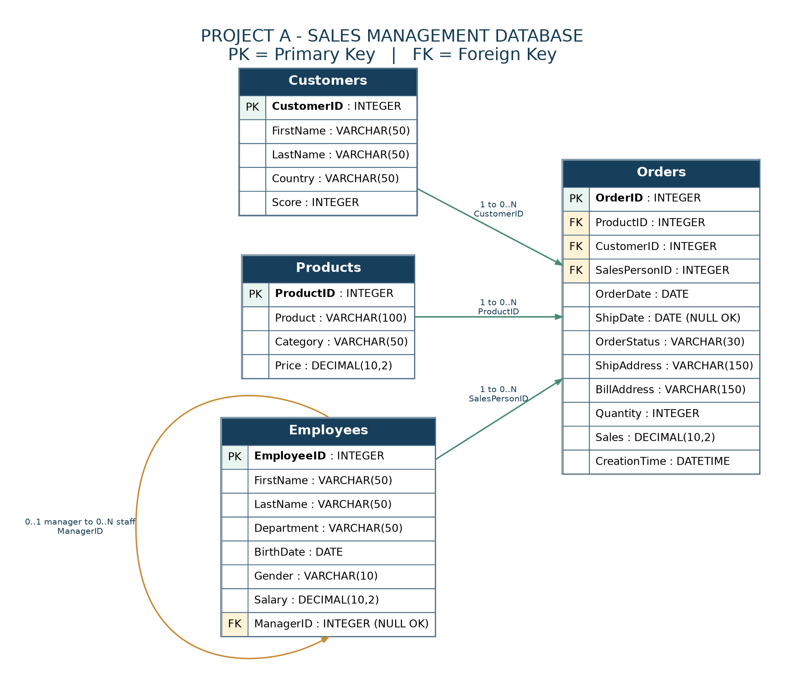
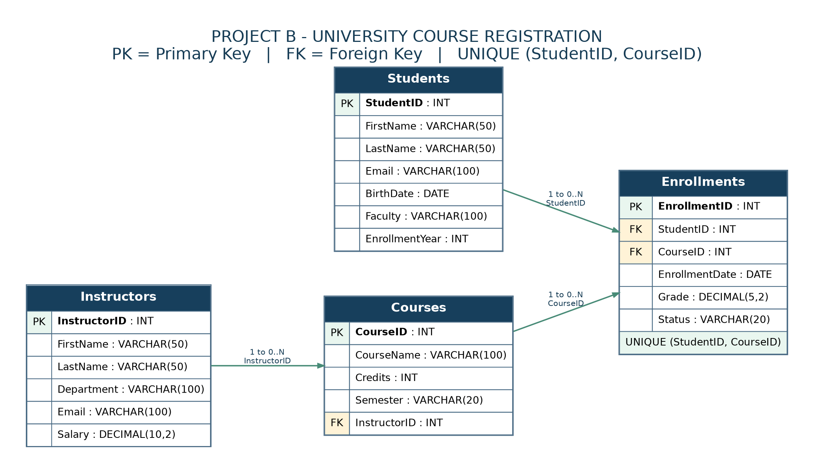

# SQL & Relational Database Design — Complete Assignment Solutions

**Dil:** Azərbaycan dili (SQL sütun və cədvəl adları tapşırığa uyğun ingiliscədir)  
**DBMS:** SQLite 3  
**Mənbə:** `Complete_SQL_ERD_Assignments_Expanded.pdf` (23 səhifə)

Bu repository-də verilən **68 SQL tapşırığının hamısı** həll olunub: 10 Basic SQL (`B01–B10`) və 6 ssenaridə 58 tapşırıq. Bundan başqa **2 ERD layihəsi** PNG/PDF/Mermaid formatında hazırlanıb.

## Fayl strukturu

```text
SQL_SalesDB_Assignments/
├── ALL_TASKS_SQLITE.sql          # Bütün SalesDB setup + 68 task, bir faylda
├── README.md
├── sql/
│   ├── 00_setup.sql             # 4 cədvəl + nümunə məlumatları
│   ├── 01_basic_tasks.sql       # B01–B10
│   ├── 02_scenario_1.sql        # 1.1–1.7
│   ├── 03_scenario_2.sql        # 2.1–2.9
│   ├── 04_scenario_3.sql        # 3.1–3.12
│   ├── 05_scenario_4.sql        # 4.1–4.10
│   ├── 06_scenario_5.sql        # 5.1–5.10
│   ├── 07_scenario_6.sql        # 6.1–6.10
│   └── 08_university_schema.sql # ERD B üçün əlavə sxem (ayrı DB)
├── erd/
│   ├── project_a_sales.png / .pdf / .mmd / .dot
│   ├── project_b_university.png / .pdf / .mmd / .dot
│   └── ERD_EXPLANATIONS.md
├── results/
│   └── TASK_RESULTS.md          # 68 task üçün faktiki nəticə cədvəlləri
└── scripts/
    ├── build_databases.py
    └── validate_and_export_results.py
```

## Necə işlətmək olar?

### Variant 1 — DB Browser for SQLite / SQLiteStudio / IntelliJ IDEA

1. Yeni SQLite bazası aç (`sales.db`).
2. `sql/00_setup.sql` faylını icra et. Bu kod bütün 4 cədvəli və **9 müştəri, 8 məhsul, 5 əməkdaş, 24 sifariş** yaradır.
3. İstədiyin tapşırığın `.sql` faylını aç və sorğunu icra et. Məsələn `sql/05_scenario_4.sql`.
4. İstəsən `ALL_TASKS_SQLITE.sql` faylını bütövlükdə icra et. **Diqqət:** daxilindəki setup `DROP TABLE` istifadə etdiyi üçün mövcud SalesDB məlumatlarını sıfırdan qurur. Ona görə boş/praktika bazasında işlət.

### Variant 2 — Terminalda Python (heç bir əlavə paket lazım deyil)

```bash
python scripts/build_databases.py
python scripts/validate_and_export_results.py
```

Birinci komanda `databases/sales.db` və `databases/university.db` yaradır. İkinci komanda **68 task-ın hamısını** icra edir, nəticələri `results/TASK_RESULTS.md`-yə yazır və əsas düzgünlük yoxlamalarını aparır.

## ERD diaqramlarına baxış

**Project A — Sales Management**



**Project B — University Registration**



## Vacib SQL qaydaları

- **`Sales` artıq sifarişin ümumi məbləğidir.** `Sales * Quantity` hesablamırıq.
- **1 sifariş = 1 məhsul:** əlavə `OrderItems` cədvəli yaratmırıq.
- **`WHERE`** sətirləri, **`HAVING`** isə qruplaşdırılmış nəticələri filtr edir.
- **`INNER JOIN`** uyğun qeydləri gətirir, **`LEFT JOIN`** isə uyğun sifarişi olmayan müştəri/əməkdaşı da saxlayır.
- **`IS NULL`** lazımdır: `= NULL` düzgün deyil.
- **`INTERSECT`** ortaq ID-lər, **`UNION`** fərqli ID-lərin birləşməsi, **`EXCEPT`** birinci çoxluqda olub ikincidə olmayan ID-lər deməkdir.
- **Ssenari 1–3** üçün tapşırıqda xüsusi filtr deyilmirsə, bütün saxlanılan sifarişlər istifadə olunur.
- **Ssenari 4 və 6** üçün keçərli satış: `OrderStatus IN ('Shipped','Delivered')`, `ShipDate IS NOT NULL`, `ShipDate >= OrderDate`. Dövr `OrderDate` ilə təyin olunur.
- **Ssenari 5** auditdir; xətalı qeydlər gizlədilmir.
- **`SAVEPOINT` və `ROLLBACK`** B10, ssenari 2 və ssenari 3-də dəyişiklikləri geri qaytarır. Beləliklə, 24 sifarişlik baza təmiz qalır.

### Bəzi real yoxlama nəticələri

| Sorğu | Nəticə |
| --- | --- |
| 1.4 — Heç sifarişi olmayan müştəri | `CustomerID = 9` (Ali Hasanov) |
| 2.3 — 7 gündən gec göndərilən sifariş | `OrderID = 202` |
| 3.5 — Satılmayan məhsul | `ProductID = 108` (Desk Lamp) |
| 5.5 — Səhv shipment qeydləri | `OrderID = 221, 222` |
| 6.7 — Hər iki dövrdə alış edənlər | `CustomerID = 1, 2, 3` |
| 6.9 — Noyabrda olub oktyabrda olmayanlar | `CustomerID = 7` |

**Bütün nəticələr:** [`results/TASK_RESULTS.md`](results/TASK_RESULTS.md).  
**ERD əlaqə izahları:** [`erd/ERD_EXPLANATIONS.md`](erd/ERD_EXPLANATIONS.md).

## GitHub-a push etmək (repo yaradıldıqdan sonra)

```bash
git init
git add .
git commit -m "Complete SQL and ERD assignments"
git branch -M main
git remote add origin https://github.com/USERNAME/REPOSITORY.git
git push -u origin main
```

`USERNAME/REPOSITORY` hissəsini öz GitHub repozitoriyanla əvəz et. Repo hələ yaradılmayıbsa əvvəl GitHub-da yaradılmalıdır; bu layihə hazırda lokal fayllardan ibarətdir, **heç yerə push edilməyib**.
